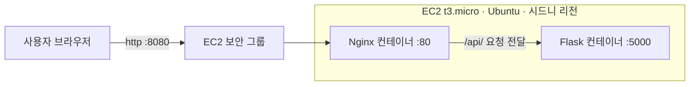

# 경동대 축제 부스 찾기·예약 서비스

축제 때 원하는 부스를 빠르게 찾고, 줄 서지 않고 미리 예약할 수 있는 웹서비스입니다.

- 배포 주소: http://3.107.114.48:8080
- 작업 버전: [커밋 번호 또는 날짜]

## 1. 서비스 소개

### 대상 사용자
축제에 참여하는 경동대학교 학생

### 접속이 몰리는 순간
축제 시작 직후와 인기 부스 예약이 열리는 시각에 검색과 예약 요청이 한꺼번에 몰립니다.

### 핵심 기능

| 기능 | 사용자 입력 | 결과 |
|---|---|---|
| 부스 검색 | 부스 이름, 종류, 위치 | 조건에 맞는 부스 목록과 남은 자리 표시 |
| 부스 예약 | 학번, 이름 입력 후 예약 버튼 | 예약 완료 메시지, 남은 자리 감소 |
| 내 예약 조회 | 학번 | 내가 예약한 부스 목록 표시 |

휴대폰과 컴퓨터 화면 크기에 맞춰 배치가 바뀌는 반응형 화면입니다.

## 2. AWS 구성도



### 요청 경로
1. 사용자가 `http://서버주소:8080`으로 접속합니다.
2. EC2 보안 그룹이 8080번 포트 요청을 통과시킵니다.
3. Nginx가 화면 파일(`index.html`)을 보여줍니다.
4. 화면에서 보낸 `/api/`로 시작하는 요청은 Nginx가 Flask로 전달합니다.
5. Flask(`backend/app.py`)가 검색, 예약, 조회 결과를 만들어 응답합니다.

### 사용한 AWS 서비스와 선택 이유

| 서비스 | 역할 | 선택 이유 |
|---|---|---|
| EC2 | 가상 서버에서 Docker Compose 앱 실행 | 로컬에서 확인한 Compose 구성을 그대로 올릴 수 있음 |

### 보안 그룹

| 포트 | 허용 대상 | 용도 |
|---|---|---|
| 22 | 전체 | 서버 접속(SSH). 학교와 집의 IP가 달라 전체로 열었고, 키 파일 인증만 허용 |
| 8080 | 전체 | 웹서비스 접속 |

### ELB · Auto Scaling 검토
적용하지 않았습니다.

- 부하: 학과 축제 규모의 동시 접속은 서버 한 대로 처리할 수 있다고 판단했습니다.
- 구조: 예약 데이터를 서버 메모리에 저장합니다. 서버를 여러 대로 늘리면 서버마다 예약 인원을 따로 세어 정원을 넘길 수 있으므로, 확장하려면 먼저 데이터를 RDS 같은 공유 저장소로 옮겨야 합니다.
- 비용: 로드 밸런서는 접속이 없어도 켜 두는 동안 요금이 발생합니다.
- 확장 계획: 이용자가 전교 단위로 늘어나면 RDS로 데이터를 분리한 뒤 ALB와 Auto Scaling을 적용합니다.

## 3. 실행 및 배포

### 폴더 구조
```
├─ docker-compose.yml   전체 실행 설정
├─ backend              검색·예약·조회 API (Flask)
├─ frontend             화면 (HTML, CSS, JavaScript)
└─ nginx                화면 제공과 API 연결 설정
```

### 로컬 실행
준비 사항: Docker Desktop

```
docker compose up -d --build
```

접속 주소: http://localhost:8080
상태 확인: http://localhost:8080/api/health → `{"status":"ok"}`

### AWS 배포
1. EC2 인스턴스 생성 (Ubuntu, t3.micro, 보안 그룹 22·8080 개방)
2. 서버 접속 후 Docker 설치
   ```
   curl -fsSL https://get.docker.com | sudo sh
   ```
3. 프로젝트 폴더를 서버로 복사
   ```
   scp -i 키파일.pem -r festival-booth ubuntu@서버주소:~/
   ```
4. 서버에서 실행
   ```
   cd ~/festival-booth && sudo docker compose up -d --build
   ```
5. 접속 확인: http://서버주소:8080

| 구분 | 포트 |
|---|---|
| 외부 접속 | 8080 |
| Nginx 컨테이너 | 80 |
| Flask 컨테이너 | 5000 |

## 4. 검증

- 시험 환경: [예: Windows 11 Chrome, 갤럭시 Chrome]
- 시험 주소: http://3.107.114.48:8080
- 시험 일시: [날짜]

| 기능 | 구분 | 입력 | 기대 결과 | 실제 결과 |
|---|---|---|---|---|
| 부스 검색 | 정상 | `타코` 검색 | 컴공 타코야끼 1개 표시 | [ ] |
| 부스 검색 | 실패 | `피자` 검색 | "검색 결과가 없습니다." | [ ] |
| 부스 예약 | 정상 | 학번·이름 입력 후 타코야끼 예약 | "예약 완료! (1/20)" | [ ] |
| 부스 예약 | 실패 | 같은 학번으로 다시 예약 | "이미 예약한 부스입니다." | [ ] |
| 부스 예약 | 경계 | 정원 2명인 취업 상담소에 3번째 예약 | "예약이 마감되었습니다." | [ ] |
| 내 예약 조회 | 정상 | 예약한 학번으로 조회 | 예약한 부스 목록 표시 | [ ] |
| 내 예약 조회 | 실패 | 학번에 `abc` 입력 | "학번은 숫자만 입력하세요." | [ ] |

[메인 화면과 기능별 화면 캡처 첨부]

## 5. 기록

### 팀 역할
[이름 - 맡은 일]

### AI 활용
[사용한 AI와 활용 범위를 직접 작성]

### 검사 후 자원 정리
검사 완료 후 EC2 인스턴스, 보안 그룹, 키 페어를 삭제합니다. GitHub 저장소와 README는 보존합니다.
